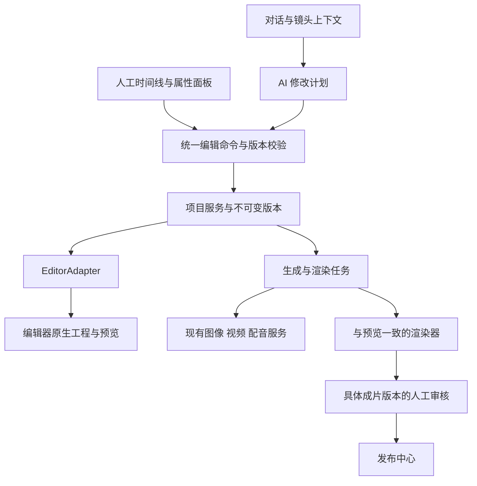

# Easel 人机协同视频工作流：代码评估与选型

评估日期：2026-11-01（Asia/Shanghai）。用户已确认：面向多个客户的产品；人工编辑目标接近剪映，包含多轨、关键帧、复杂转场和效果。

## 1. 建议

采用“Easel 对话与制作编排 + 可视化编辑器 + 版本化项目服务 + 成片审核”的架构。AI 和人工操作同一个工程，并经过同一套编辑命令。

OpenCut 比 Hypit 更适合作为人工剪辑界面的候选，但目前应评估固定版本的 **opencut-classic**。OpenCut 新主干还不能承担生产编辑器；classic 已归档，采用它意味着自己维护编辑模块和导出链路。

用户随后明确希望保留 Hypit 的参考视频复刻能力。建议细化为 **Hypit 负责参考分析与生成初稿，OpenCut classic 负责人工二次加工，Easel 负责工程交接、局部修改与版本审核**。桥接采用原生可编辑轨道与可局部重渲染组件混合，具体设计见 [Hypit → OpenCut 分层工程交接](hypit-opencut-handoff-design.md)。Hypit 当前许可证对多客户托管的附加限制仍需处理。

如果产品希望尽快交付较完整的编辑体验，应与一个商业 SDK 做相同素材、相同操作的对照验证，而不是凭功能列表直接选型。IMG.LY CE.SDK 可以进入对照组，但其当前 Web 关键帧能力也有明确限制，见下文。

## 2. 本轮检查范围与证据

- 本地 Easel：`5a597e5`。盘点 29 个 `easel/` Python 模块、39 个前端 TS/TSX 文件、75 个 Web 路由、115 个内置技能。
- 沿用户工作流追踪：对话及执行引擎、SSE/事件回放、文件上传、产物预览、内容库、视频生成、短剧逐镜生成与音画对齐、FFmpeg 合成复用、Remotion 视频产线、人工发布及相关测试。
- 无关技能和第三方 vendor 做目录及调用关系盘点；本轮不是所有文件逐行安全审计，也没有做多客户负载验收。
- OpenCut 主干检查版本：`e668010778568641babef2cc40be4703ae6916d6`。
- opencut-classic 检查版本：`cf5e79e919144200294fb9fed22a222592a0aeea`。
- Hypit 检查版本：`0762c6be56c0af43fff3cdbdb285e21414dd249b`；检查 Studio、源码回写、评论存储、Runtime 和许可证。
- 本轮没有安装 Hypit/OpenCut、调用付费模型、修改供应商配置或发布内容。OpenCut 在线首页可访问，但项目页在本轮浏览器中未完整呈现，因此没有把在线演示算作剪辑/导出验收。

本地针对相关链路运行：

```sh
.venv/bin/python -m pytest \
  tests/test_artifact_checkpoints.py \
  tests/test_assemble_checkpoints.py \
  tests/test_assemble_resume_ffmpeg.py \
  tests/test_manual_publishing.py \
  tests/test_chat_event_log_recovery.py -q
```

结果：**73 passed**，没有跳过；包含真实 FFmpeg 的合成与损坏恢复测试。有一条 Starlette/httpx 弃用提示。该结果证明已有局部链路的回归状态，不证明新的协同编辑工作流已实现。

## 3. Easel 现有代码能复用什么

| 层 | 已有能力与源码 | 与目标的差距 |
|---|---|---|
| 对话与 Agent | `easel/harnesses/`、`web/app.py:2928` 起的事件日志、后台任务和 SSE；`App.tsx` 管理跨页面流式状态 | 没有视频项目 ID、所选镜头、工程版本等结构化编辑上下文；对话生命周期与制作项目生命周期需要解耦 |
| 产物展示 | `MessageBubble.tsx`、`ArtifactGallery.tsx:73`、`OutputsPage.tsx:176` | 视频仍是播放器与文件预览，没有时间线、参数面板、修改集或版本比较 |
| 素材生成 | `ai_image.py`、`ai_video.py`、`tts.py`、`ai_music.py`、`model_registry.py` | 可保留供应商适配能力；应由项目级任务服务保存请求及结果，不靠长驻对话进程作为唯一任务所有者 |
| 自动短视频 | `auto-short-video/SKILL.md`、`scripts/assemble.py` | 有 storyboard、图片/视频、字幕、配音和 BGM，但不是自由多轨工程格式 |
| 短剧 | `short-drama/scripts/drama_ops.py`、`dubbing.py` | 有角色参考、镜头、台词、原生对白审计、音画对齐；缺少用户可操作的工程 UI 和候选版本管理 |
| 合成恢复 | `artifact_checkpoints.py`、`assemble.py:418` 起 | 有内容指纹、产物校验、独占锁和原子交付；其边界明确为可重做的本地计算，不保证付费 API 恰好执行一次 |
| 视频产线 | `video-production/scripts/video_pipeline.py` 及 vendor SDK | 已有设计表和预览两道确认、质量门、人审包；主要面向已有原片包装，不能覆盖全部从对话生成并自由编辑的流程 |
| 内容归档 | `manifest.py`、`.easel.json`、`/api/outputs` | 有展示头与工作流步骤；不是带并发版本控制的剪辑工程数据库 |
| 人工发布 | `ManualPublishPage.tsx`、`easel/manual_publish.py` | 已有人工核对与导出；应扩展为可审计的成片版本审批，再交给发布流程 |

两个需要专门处理的源码细节：

1. `drama_ops.py:370` 按片段文件存在性跳过生成，`:393` 为同一镜头选择固定输出名。它能帮助续跑，但不能直接支持“同镜头多个候选、旧版本回退、修改 prompt 后精确失效”的产品语义。需要不可变素材版本与请求指纹。
2. `ManualPublishPage.tsx:66` 的审核快照包含标题、正文、话题和媒体路径；后端 `manual_publish.py:36` 检查 `reviewed` 布尔值。媒体内容在同一路径替换时，路径快照不足以证明审核对象相同。它适用于当前本地交互，不能直接当成多客户产品的服务端审批账本。

## 4. OpenCut：适合在哪一层

### 4.1 新主干目前是重写中的项目

[主 README](https://github.com/OpenCut-app/OpenCut/blob/e668010778568641babef2cc40be4703ae6916d6/README.md) 明确说明正在重写；本轮看到的 [Web 编辑页](https://github.com/OpenCut-app/OpenCut/blob/e668010778568641babef2cc40be4703ae6916d6/apps/web/src/routes/editor.tsx) 仍显示 `Coming soon`。

[重写追踪 #811](https://github.com/OpenCut-app/OpenCut/issues/811) 把 Editor API、插件、MCP、无头渲染、项目存储和跨平台核心列入计划。不能据此声称这些接口已可集成，也没有可依赖的上线时间。

### 4.2 classic 已有有用的编辑基础

[classic README](https://github.com/OpenCut-app/opencut-classic/blob/cf5e79e919144200294fb9fed22a222592a0aeea/README.md) 声明已归档且不再维护；Web 为 Next.js/React，渲染涉及 Rust/WASM 和 Mediabunny。

本轮源码确认：

- [timeline/types.ts](https://github.com/OpenCut-app/opencut-classic/blob/cf5e79e919144200294fb9fed22a222592a0aeea/apps/web/src/timeline/types.ts)：视频、文字、音频、图形、效果轨道及片段时长、裁剪、动画数据。
- [animation/types.ts](https://github.com/OpenCut-app/opencut-classic/blob/cf5e79e919144200294fb9fed22a222592a0aeea/apps/web/src/animation/types.ts)：位置、缩放、旋转、透明度、音量、颜色等关键帧，以及线性、保持和贝塞尔曲线。
- [CommandManager](https://github.com/OpenCut-app/opencut-classic/blob/cf5e79e919144200294fb9fed22a222592a0aeea/apps/web/src/core/managers/commands.ts) 与 [TimelineManager](https://github.com/OpenCut-app/opencut-classic/blob/cf5e79e919144200294fb9fed22a222592a0aeea/apps/web/src/core/managers/timeline-manager.ts)：添加、移动、拆分、效果和关键帧等命令，以及撤销重做。适合由同一入口接收人工与 AI 操作；这是集成判断，不是已存在的远程 Agent API。
- [存储服务](https://github.com/OpenCut-app/opencut-classic/blob/cf5e79e919144200294fb9fed22a222592a0aeea/apps/web/src/services/storage/service.ts)：工程使用 IndexedDB，素材使用 OPFS。需要新增云端存储及同步，不能把浏览器本地保存当成团队协作。
- [SceneExporter](https://github.com/OpenCut-app/opencut-classic/blob/cf5e79e919144200294fb9fed22a222592a0aeea/apps/web/src/services/renderer/scene-exporter.ts)：浏览器 Canvas/Mediabunny 导出；不能据此承诺已具备多客户云端后台渲染服务。

复杂效果仍是缺口：[默认效果注册表](https://github.com/OpenCut-app/opencut-classic/blob/cf5e79e919144200294fb9fed22a222592a0aeea/apps/web/src/effects/definitions/index.ts) 本轮只看到 blur。可扩展的框架不等于丰富的现成特效库；重写追踪也把转场、滤镜和扩展效果库列为后续工作。

### 4.3 商用与维护判断

[MIT 许可证](https://github.com/OpenCut-app/opencut-classic/blob/cf5e79e919144200294fb9fed22a222592a0aeea/LICENSE) 允许在保留相应版权与许可声明的条件下修改、分发和商用。名称、素材及依赖仍分别按各自条件处理。

对本产品的建议是：固定 classic 版本，在独立编辑器模块中验证；通过后再决定是否承担长期维护。不把新主干的计划能力写进产品承诺，也不在 Easel 里直接散布对 classic 内部类的依赖。

## 5. Hypit 及其他方案

| 方案 | 与本需求的关系 | 当前必须算入的成本或限制 |
|---|---|---|
| OpenCut classic | 开源人工编辑层候选；多轨/关键帧/命令模型有基础 | 已归档；复杂转场、效果库、云存储、后台渲染和 AI 接口需要验证/建设 |
| OpenCut 新主干 | 长期跟踪的新架构 | 当前编辑页还是占位；不能当可交付底座 |
| Hypit | 适合 Agent 生成、语义时间线、组件创作及复用 | 不是完整通用 NLE；GUI 能改哪些值依赖组件 Companion；多客户托管涉及商业授权 |
| Twick | React 编辑器 SDK，集成形态较合适 | LICENSE 为 SUL；README 与 LICENSE 对 SaaS 的描述存在需澄清之处，不能按 MIT 采用 |
| IMG.LY CE.SDK | 商业 SDK 对照候选，多轨/字幕/转场/效果有文档与接口 | 需商业报价；当前关键帧 API 仍标实验性，文档明确编辑器没有关键帧控件，需要自己补 UI |
| 现有 Remotion/FFmpeg | 继续负责已有模板、确定性合成和媒体处理 | 不能自动变成完整编辑器；Remotion 也有自己的商业许可条件 |

Hypit 的 [Studio 文档](https://github.com/hypit-ai/hypit/blob/0762c6be56c0af43fff3cdbdb285e21414dd249b/docs/quickstart/preview.md) 确认：可预览、编辑暴露参数、操作支持的时间线控制，并将修改回写 `.svml/.svs/.svrun`；Comments 写到 `FEEDBACK.json`。本轮检查的评论结构记录 Run 与秒数，不能代替本产品的成片哈希审批；评论通知 Agent 的产品闭环也需要宿主接入。

[Hypit LICENSE](https://github.com/hypit-ai/hypit/blob/0762c6be56c0af43fff3cdbdb285e21414dd249b/LICENSE) 是附加条件的 Apache 2.0 版本，明确区分自用/本组织单租户与对第三方提供托管、多租户服务等场景。按用户已确认的多客户产品范围，应先取得相应商业授权，不能因改成 CLI 或独立进程就假设不受这些条款约束。

不要直接做“Hypit 出完整 MP4 → 导入 OpenCut”作为完整协同方案。导入后可以剪片段，但已经烧进画面的字幕、图形和动效不会重新变成可编辑图层。两者的语义工程与原生剪辑工程之间若要互通，需要专门的映射及能力边界。

其他来源：[Twick LICENSE](https://github.com/ncounterspecialist/twick/blob/main/LICENSE.md)、[Twick Studio 接口](https://github.com/ncounterspecialist/twick/blob/main/packages/studio/README.md)、[CE.SDK 视频编辑](https://img.ly/docs/cesdk/react/create-video/overview-b06512/)、[CE.SDK 关键帧限制](https://img.ly/docs/cesdk/react/animation/keyframes-267836/)、[CE.SDK 报价](https://img.ly/pricing/)、[Remotion 商业许可](https://www.remotion.dev/docs/license/pricing)。这些外部条件按评估日记录，落地应锁定实际版本和合同。

## 6. 产品应如何工作

1. 用户在对话中给目标、原素材和参考。AI 形成脚本/分镜草稿，并明确画幅、时长、素材来源和生成范围。
2. 需要生成的部分进入镜头任务，用户可以在候选中选择；确定性裁剪、字幕修改、音量修改无需重新生视频。
3. AI 交付分层工程：画面、字幕、配音、BGM、图形保持独立。聊天卡片提供“打开编辑”“修改这个镜头”“提交审核”。
4. 编辑页保留对话面板，中间预览、底部多轨、右侧属性。当前选中片段、时间范围和工程版本自动进入 AI 上下文。
5. 用户直接拖动或告诉 AI“第 3 镜缩短一点，保留我改过的字幕”。AI 输出局部修改，用户能看见变更并撤销整次 AI 修改。
6. 审核者针对一个冻结版本看完整预览，留下带镜头定位的意见。创作者可以手改，也可让 AI 按意见修改；再提交新版本。
7. 最终导出与审批绑定。修改素材、字幕、声音、时间线或效果后产生新版本；此前的通过记录仍留在历史中，但不能替新版本放行。

脚本/分镜阶段的确认、编辑过程中的意见和最终发布审批是不同动作。可以按项目配置审核节点，不必每改一个参数弹一次审批。

## 7. 建议的工程架构



### 工程与版本

- 项目服务保存 `tenant_id / project_id / revision / engine / engine_version`，并保留编辑器原生文档作为权威编辑状态。
- Brief、脚本、分镜意图、镜头 ID 与素材 ID 的映射单独保存。不要为了跨引擎而先把全部关键帧/效果压缩成简化 storyboard，导致人工编辑信息丢失。
- OpenCut 的 schema version 和产品每次修改的 revision 分开管理。升级引擎必须显式迁移并可回退。
- 素材版本不可变：同镜头重生成产出新 asset version，保留候选和旧选用关系。路径或临时签名 URL 都不充当素材身份。

### 人工与 AI 共用命令

首批可以支持 `insertClip / splitClip / trimClip / moveClip / replaceClip / updateText / setVolume / upsertKeyframe`，每项由适配器调用已验证的原生命令。转场只有在实际引擎实现并通过导出验收后才声明支持。

每个修改批次带 `base_revision / operation_id / actor / selected_ids`。服务端检查权限、素材归属、参数和当前版本；版本冲突时返回明确冲突，不默默覆盖人工改动。保存成功后统一产生新 revision、变更记录及预览更新。

人手改过或锁定的属性进入 AI 可见上下文；AI 若要改动这些值，先展示冲突。撤销重做与业务版本历史分别处理：浏览器内存的 undo 栈不能代替服务端可追溯历史。

### 任务与费用

素材生成、ASR、转码、代理预览、成片导出分为独立任务。任务保存 provider、请求指纹、远端 task ID、输入版本、结果和失败原因。

请求超时且未确认是否提交成功时先进入“结果待确认”，能查询就查询，不能安全确认则交给明确的重试选择，避免自动重发付费任务。已有本地检查点继续用于可重做的本地计算，不扩展为远端付费动作的幂等保证。

### 预览与导出

优先使用同一引擎、同一工程快照和同一素材清单。验证字体、关键帧、时间基、音频、透明度、转场和最终分辨率的一致性。

OpenCut classic 的云端渲染路径需单独验证浏览器 GPU/WASM、WebCodecs 和字体部署。不能把任意多轨工程交给现有简单 FFmpeg assembler，然后宣称完全保留编辑效果。FFmpeg 继续适合预处理、转码、响度处理和已有简单合成。

### 审核与多客户

- 审核记录至少绑定工程 revision、成片 artifact ID/hash、素材内容摘要、渲染配置、审核人、结论、时间和意见。
- 意见绑定 `clip_id + reviewed_revision + time_range`；重排镜头后保留原定位并提示可能需要重定位，避免只存全片某一秒导致意见指错对象。
- 发布接口在服务端校验当前实际提交的文件与已通过版本一致。AI 提供检查建议，不充当人工审批身份。
- Easel 现有 Origin/Host/回环写守卫是本地应用边界，不是客户身份与租户隔离。多客户版本要补身份认证、成员权限、项目范围、对象存储权限及 worker 隔离，不能共享当前的全局 `.env`、目录和 Agent 工作区给不同客户。
- 第一版可以按项目单写者/短时编辑租约处理并发；暂不需要一开始实现多人同时拖同一时间线的实时协同。

## 8. 落地顺序与决策条件

### P0：编辑器验证

固定 classic 版本，独立运行；使用无敏感内容的 45–60 秒样片，至少含两路视频、独立字幕、旁白、BGM、图片叠加及关键帧。不需要先调用任何生成模型。

验收必须包括：AI/程序构造原生工程 → 人工裁剪和关键帧修改 → 保存重开 → 再次 AI 局部修改 → 保留人工结果 → 撤销 → 导出 → 对比音画与效果。复杂转场作为明确的缺口项处理，不伪装为已有功能。

同时判断：React/Vite 集成边界、引擎依赖、中文字体、浏览器内存、编码支持、关键帧 UI、云端导出可行性和团队维护意愿。商业 SDK 用同一份操作清单对照，尤其验证关键帧控件是否需要自行开发。

P0 通过才选择生产编辑器。若 classic 的导出和维护成本不可接受，不把整个产品绑在归档版本上；若选择自研维护，记录固定版本、依赖、允许能力和待补模块。

### P1：人机混合最小闭环

新增视频项目页、原生工程保存、局部命令接口、素材候选、版本历史、具体成片审核。保留现有对话、生成供应商和人工发布能力。

最有代表性的验收故事：AI 出六镜初稿；用户换两段素材并调整关键帧；AI 只修改一条字幕；审核者留下意见；修订后重新审核；导出交给发布中心。

### P2：多客户产品化

增加客户/成员权限、项目数据库、对象存储、队列与 worker、用量记录、远端任务恢复、冻结审核版本和发布绑定。验收客户 A 不能读/改/渲染/下载客户 B 的任何工程或素材。

### P3：扩大编辑与生成能力

按真实使用频次补转场、效果和模板；再考虑语义重剪、镜头连续性、高级动画或经授权的 Hypit 制作后端。每项都要求预览、保存重开、人工续改、AI 续改和最终导出的一致性测试。

本轮仅完成源码评估、相关回归和落地设计；尚未实现或宣称通过上述新工作流验收。
