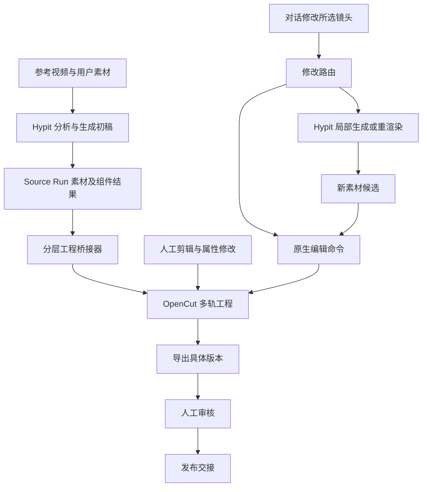

# Hypit → OpenCut：复刻初稿、人工加工与审核

日期：2026-11-01。本文将上一轮选型细化为用户提出的组合方案；这是基于源码的集成设计，桥接器与产品闭环尚未实现。

## 1. 组合分工

- **Hypit**：分析参考视频的脚本结构、节奏、镜头与视觉关系，使用用户素材和生成素材创作初稿，保留可复用的 Source、Run、组件与结果。
- **工程桥接器**：解析已经求值的时间线、轨道、素材、字幕及组件关系，输出分层交接包并构造 OpenCut 原生工程。
- **OpenCut classic**：呈现多轨工程，供人剪辑、替换素材、改字、调声音及编辑支持的关键帧；特殊组件通过扩展属性面板修改参数并局部重渲染。
- **响芽**：管理对话、项目、任务、素材版本、当前编辑状态、审核及发布交接。

Hypit 完成初稿后，用户得到一份参考成片和一个可编辑工程。参考成片用于对照复刻效果；人工加工以分层工程为基础。

## 2. 已找到的桥接基础

以 Hypit `0762c6be56c0af43fff3cdbdb285e21414dd249b` 和 OpenCut classic `cf5e79e919144200294fb9fed22a222592a0aeea` 为源码基线：

- Hypit [Visual Track](https://github.com/hypit-ai/hypit/blob/0762c6be56c0af43fff3cdbdb285e21414dd249b/packages/visual-track/README.md) 提供 `.program` 给工具使用；`VisualClipProgram` 包含已解析的片段区间、空间映射、层级、素材及运动信息。
- Hypit [Audio Track](https://github.com/hypit-ai/hypit/blob/0762c6be56c0af43fff3cdbdb285e21414dd249b/packages/audio-track/README.md) 也提供 `.program`，包含独立声音片段、来源、采样映射、音量和淡入淡出。
- Hypit [Caption 类型](https://github.com/hypit-ai/hypit/blob/0762c6be56c0af43fff3cdbdb285e21414dd249b/packages/caption/src/types.ts) 分开表达展示文字和解析后的帧级时间，提供字幕导出的基础。
- Hypit [Composition](https://github.com/hypit-ai/hypit/blob/0762c6be56c0af43fff3cdbdb285e21414dd249b/packages/composition/README.md) 的终端视觉类型除文本、图片、视频外，也包含 `surface` 和 `program`。后两类可能由自定义代码决定内部布局与动画，不能按普通素材列表无损反推为 OpenCut 对象。
- OpenCut [原生工程元素](https://github.com/OpenCut-app/opencut-classic/blob/cf5e79e919144200294fb9fed22a222592a0aeea/apps/web/src/timeline/types.ts) 和 [动画模型](https://github.com/OpenCut-app/opencut-classic/blob/cf5e79e919144200294fb9fed22a222592a0aeea/apps/web/src/animation/types.ts) 能接收视频、图片、音频、文字以及支持的变换关键帧。

结论是可以建设桥接器，但本轮检查的公开接口没有提供一个现成的“导出 OpenCut 工程”命令。以下交接协议、属性面板和路由均是拟新增能力，不是 Hypit/OpenCut 已有功能。

## 3. 分层交接策略

| Hypit 内容 | 进入 OpenCut 的方式 | 人工修改范围 |
|---|---|---|
| 普通镜头、B-roll、图片 | 原生视频/图片元素，保留原始素材与入出点 | 裁剪、拆分、排序、替换、支持的空间变换 |
| 配音、BGM、环境声、音效 | 独立音频元素；音量和包络按支持范围映射 | 混音、移动、裁剪、替换；不需要重新生视频 |
| 普通字幕、标题 | 原生文字元素，保留文本、字体引用和解析后的时间 | 改字、位置、样式、时长；排版精度需验收 |
| 支持的位移、缩放、旋转、透明度 | 转成原生关键帧 | 用编辑器继续加工；缓动曲线与坐标转换需核验 |
| 特殊花字、卡片、复杂代码动画、跨镜头效果 | 作为带来源绑定的生成组件导入；不支持的表现局部预渲染 | 整体剪辑/摆放；内部通过暴露参数或对话修改，交 Hypit 局部重渲染 |
| 无法映射且未提供可重渲染边界的内容 | 显式标注为烘焙内容或拒绝交接该部分 | 不承诺内部图层可编辑，不静默丢效果 |

第一版无需修改 OpenCut 的全部元素类型：可以用原生 `VideoElement` 承载生成组件，把 Hypit 来源、可编辑参数和依赖绑定保存在 响芽 项目服务中，扩展属性面板识别这种绑定。

透明动态图层的导出格式、alpha 保留和 OpenCut 解码合成需要验证，不能把“支持视频”视为支持任意透明视频。若无法透明交接，则把受影响的最小视觉组合预渲染，清楚展示该组合包含哪些不可独立编辑的内容。

字幕默认单独交接；对于原生文字不能重现的复杂逐字效果，可以保留 Hypit 效果组件，提供改词/样式参数与重渲染。不能同时把已烧录字幕和可见原生字幕叠加，造成重复。

## 4. 为什么需要工程包

仅导出完整 MP4 会丢失字幕、配音、BGM 和图形的独立编辑边界。交接包应包含：

1. 参考成片、封面和必要的预览代理。
2. 原始/生成素材，以及不可变的素材 ID、内容摘要和来源。
3. 已求值的片段区间、源入出点、画布、层级、文字、音频和可映射动画。
4. 特殊组件的 Source/Run/版本引用、被复用的结果引用、可修改参数及依赖。
5. 原生元素与 Hypit 对象之间的稳定 ID 映射，以及支持/烘焙/需重渲染的能力清单。

拟建的协议可以称为 `easel.hypit-handoff/v1`；它不是任何一方现有的官方格式。它服务于一次可复现交接和后续来源追踪，不替代完整 Hypit Source，也不把 OpenCut 工程压缩为简化 storyboard。

交接器应在真实素材、配音和对齐结果就绪后解析时间，不能只读取原始 SVML 中尚未求值的语义锚点。帧率保留有理数，视频时间使用明确的帧区间，声音按自身采样时间映射；避免逐项四舍五入造成累计错位。

空间转换需要处理画布、裁剪、fit、变换原点、层级和字体。Hypit 的绝对 `z` 不等于简单按 Film 子节点顺序排列；复杂采样映射与不兼容的视觉效果应转为生成组件，而不是近似映射后不告知。

## 5. 人工修改后，AI 怎样继续接手

在首次交接点保存 Hypit 初稿与 OpenCut 工程快照。之后 **OpenCut 当前工程是剪辑与排布的权威状态**；Hypit Source 作为生成来源持续保留。

不做两个可变工程之间的隐式全量覆盖，也不要求第一版支持任意双向无损转换。

| 用户要求 | 执行路径 |
|---|---|
| “第三镜缩短半秒” | 修改 OpenCut 原生片段；不调用生成模型 |
| “把这句字幕改成另一句，其他都别动” | 修改原生文字；若是特殊字幕组件则只重渲染该组件 |
| “主角换个人，但保留我剪好的节奏” | Hypit 按该镜来源生成新候选，再替换素材；保持现有裁剪、位置和人工覆盖属性 |
| “这张卡片换一组颜色，动画照旧” | 修改绑定的组件参数，复用已有素材，局部重渲染；通过原生命令替换该组件版本 |
| “重写整段旁白” | 先生成候选声音并比较时长，明确是否保持现有时间线或调整受影响区间，再提交修改集 |

局部生成完成后不能默认重建全部 OpenCut 工程。新素材有新的 asset version；旧素材与旧工程仍可回退。每次 AI 修改带 `base_revision`、对象 ID 和操作批次，发生人工并发修改时返回冲突。

如果跨镜头转场被预渲染，修改其任一输入镜头、边界或时长会使该转场组件失效。桥接器要保留输入依赖、转场范围及所需素材余量，只重渲染受影响区域。切开烘焙组件不等于能无损重排其内部动画，应在编辑器中明确这个边界。

## 6. 预览、导出与审核

Hypit 参考成片与 OpenCut 初始导入结果应做同版本对照。原生映射需检查关键帧、字体、字幕、源采样、音频与层级；烘焙组件需检查边界衔接及音轨是否重复。

最终交付由 OpenCut 当前工程导出或由同等语义的已验证渲染服务完成。用户手改之后，不能拿未吸收这些修改的旧 Hypit 全片当最终交付。

审核绑定工程 revision、实际成片摘要、素材版本和渲染配置。审核意见记录对象与所审版本；变更成片后创建待审新版本。复刻质量评估、AI 建议和人工签署分别保留。

## 7. 响芽 的新增模块

| 模块 | 责任 |
|---|---|
| HypitRunner | 生成任务、Run/Build/结果引用与状态；复用已接受输出 |
| HandoffExporter | 从求值结果及组件适配器提取工程包；标注可编辑边界 |
| OpenCutImporter | 注册素材、创建原生轨道及对象、保存来源绑定 |
| EditRouter | 把修改分为原生命令、素材生成、组件重渲染；保护人工修改 |
| ComponentInspector | 在 OpenCut 属性面板显示组件参数、预览、候选版本和重渲染状态 |
| Project/ReviewService | 多客户项目权限、工程版本、修改记录、冻结审核与发布绑定 |

建议第一阶段把 classic 作为独立编辑器前端接入 响芽，以项目 API 交接；隔离其 Next.js、WASM 和媒体依赖。需要同页体验时，可采用受控的编辑器页面嵌入及结构化消息协议。这样先验证完整工作流，再考虑抽成可嵌入组件；身份、项目权限和素材访问仍必须由服务端校验。

## 8. 第一轮验证样片

选择一条有参考结构的 30–60 秒样片，覆盖六个镜头、独立配音/BGM、中文字幕、一处简单关键帧与一处 Hypit 特殊动效。验收按顺序进行：

1. Hypit 完成初稿，保留 Source/Run/素材，输出参考成片和工程包。
2. OpenCut 展示多轨，普通字幕和声音可单独编辑，特殊组件明确标识。
3. 人工裁剪镜头、调 BGM、修改一条字幕和关键帧，保存后重开不丢失。
4. 通过对话只替换一个镜头候选；人工修改保持不变。
5. 修改特殊动效中的文字或颜色，只重渲染这个组件，再无损替换该候选。
6. 导出实际修改后的版本，对照播放、字幕和音频；通过后才能提交该版本审核。

首轮不要求把任意 Hypit 程序无损翻译为 OpenCut 图层。先覆盖普通素材、字幕、声音、简单关键帧及一类可重渲染组件，用真实端到端证据确认组合价值。

## 9. 当前限制

- 上述桥接器、修改路由和属性面板是拟新增能力，尚未实现或验收。
- OpenCut classic 已归档；仍需固定版本并承担维护与导出适配。
- Hypit 的 [当前许可证](https://github.com/hypit-ai/hypit/blob/0762c6be56c0af43fff3cdbdb285e21414dd249b/LICENSE) 对多客户托管等使用有附加商业授权要求；组合或独立进程部署不意味着自动获得该授权。
- 本次补充是源码与设计验证，没有实际提交付费复刻任务，也没有承诺任意参考视频都能自动实现同等质量。
